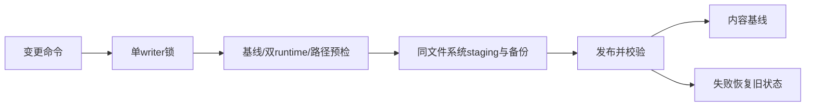

# 安全管理合同

基线runtime-baseline.v1.tsv覆盖每Skill的文件/目录相对路径、内容、执行权限和空目录。拒绝symlink/特殊文件及TAB/CR/LF路径，支持中文空格。所有变更共用预检，runtime对比上次同步基线而非新source。保留原profile/source.local/manifest格式。

state migrate仅信任旧source.local，双runtime与原source精确一致且profile/manifest匹配才建立基线；缺源/差异即停，无force。目标governance须静态声明safe contract v1，禁止降级。新manager可迁移rc.1，工具回滚不降级manager。

变更使用同一写锁及事务staging；记录旧/新目标摘要、备份和阶段。普通失败及可捕获中断回滚；不可捕获残留需显式state recover --transaction ID，恢复前校验目标只能处于记录中旧/新状态，事务外用户改动不覆盖。不执行journal代码，不接受任意路径。dry-run无项目持久写入。

测试复用scripts/test_skill_manager.py：drift/迁移/升级/卸载/冲突/路径/故障恢复/锁。命令级测试由owner证据runner记录；不跑race或其他owner。
